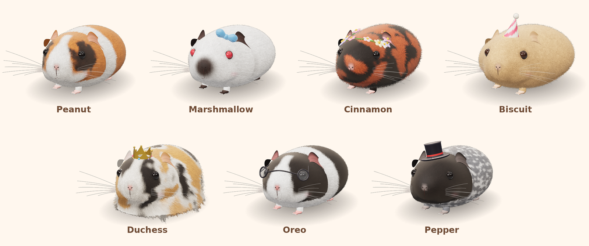
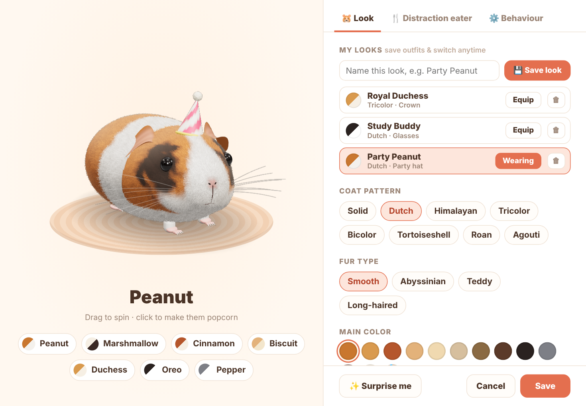

# Guinea Pig Pal!!!

A realistic, furry 3D guinea pig that lives in the corner of your desktop (Windows & Mac). It's fully customizable, and it **eats your distractions**.



## What it does

| Interaction | What happens |
|---|---|
| **Hover + wiggle your mouse over it** | Petting! Eyes close, cheeks blush, it purrs, hearts float up |
| **Click** | Popcorns (happy guinea pig jump) and wheeks |
| **Drag** | Pick it up and put it anywhere on screen |
| **Double-click** | Opens the customizer |
| **Right-click** (or the tray / menu-bar icon) | Feed (carrot, lettuce, strawberry, bell pepper), nap, settings, quit |
| **Moving your mouse around** | It watches your cursor |
| **Typing / using the computer** | Nibbles every now and then |
| **Away from the computer for 2+ minutes** | Takes a nap (zzz), wakes up when you're back |
| **Left alone** | Grooms, sniffs, looks around, wanders along the bottom of the screen |
| **Hungry** | Wheeks at you for food |

The window is see-through and clicks pass through everywhere except on the guinea pig itself, so it never gets in your way.

Hunger and happiness are saved between sessions. Feeding and petting keep them up. It never gets sick or dies, it just gets a bit needy. 

## 🍴 Distraction eater

![Eating a distraction]

Choose the websites and apps that distract you, and give each one a time limit. Go over the limit and your guinea pig walks out, **eats the tab bite by bite** (crumbs and all), burps, and the tab or app is actually closed.

- Turn it on in **Customize → Distraction eater** (or right-click → Distraction eater → On).
- Add any **website** (`instagram.com`) or **app** (`Discord`). Quick-add buttons cover the usual suspects.
- Each item gets its **own timer** (e.g. Instagram 5 min, YouTube 15 min) and its own on/off switch.
- **Per visit**: the timer resets after a 5-minute break. **Per day**: a daily allowance, then it's eaten on sight.
- It warns you at **1 minute left** (speech bubble + notification) and counts down the last 10 seconds.
- Apps can be **closed** (they can still ask you to save) or just **hidden**.
- **Pause** it for 15 minutes or an hour from the right-click menu.
- **Preview the eating animation** button to see it without losing a tab.

**How detection works**
| | Websites | Apps |
|---|---|---|
| **Windows** | Reads the browser window title (e.g. "Instagram - Google Chrome") | Process name |
| **Mac** | Reads the real URL from Chrome, Safari, Arc, Edge, Brave, Vivaldi, Opera (asks for permission once per browser: click **OK**) | App name |

On Mac, Firefox only exposes the window title, and that needs **Accessibility** permission. For the realistic chomp, where it eats a picture of your actual screen, macOS needs **Screen Recording** permission. Without it, it eats a drawn version of the tab.

## Customization



- **Coat patterns:** Solid, Dutch, Himalayan, Tricolor, Bicolor, Tortoiseshell, Roan, Agouti
- **Fur types:** Smooth, Abyssinian (real swirling rosettes), Teddy, Long-haired (Peruvian-style coat that drapes to the floor)
- **Colors:** main, second, and light fur; eyes; nose & paws. Pick from real guinea pig colors or any custom color
- **Chonk and size sliders**
- **Shuffle patches** to rearrange where the colors land
- **Accessories:** bow, party hat, flower crown, glasses, top hat, crown (each with a color)
- **Name** it, and use 7 presets or ✨ *Surprise me*
- **My looks:** save outfits under a name, then equip or delete them anytime (also from the right-click menu → *Saved looks*)
- **Behaviour toggles:** wander, sounds, nap when idle, always on top, start at login

Changes show live on the desktop pet while you edit. Cancel reverts them.

---

## Running it (for development)

1. Install **Node.js** (LTS) from https://nodejs.org
2. In this folder, run:
   ```bash
   npm install
   npm start
   ```

## Testing in VS Code

1. Install **Node.js** (LTS) from https://nodejs.org and **VS Code**.
2. Unzip the project, then in VS Code: **File → Open Folder…** → pick the `piggy` folder.
3. Open the terminal (**Terminal → New Terminal**) and run `npm install` (one time only).
4. Go to the **Run and Debug** panel (▶ with a bug icon, or `Ctrl+Shift+D` / `Cmd+Shift+D`), pick a config from the dropdown, and press the green ▶:
   - **▶ Run Guinea Pig Pal**: the normal app.
   - **⚡ Test: fast distraction timers**: minutes count as *seconds*, so a 5-minute Instagram limit eats the tab after 5 seconds.
   - **🍴 Test: play the eating animation on launch**: shows the chomp 3 seconds after starting, and never closes anything.
5. After editing code, press **Ctrl+Shift+F5** (`Cmd+Shift+F5` on Mac) to restart. To quit, right-click the guinea pig → **Quit** (or the red ■ stop button).

Errors from the app show in VS Code's **Debug Console**. For errors inside a window, click the guinea pig and press `Ctrl+Shift+I` (`Cmd+Option+I` on Mac) to open DevTools.

**Just want to play with the look?** Install the **Live Server** extension, right-click `src/renderer/customize.html` → **Open with Live Server**. The customizer runs in your browser. `src/renderer/eat.html?demo&nocap` plays the eating animation.

## Releasing an update (Mac + Windows)

The project lives at **github.com/allysonmw/guinea-pig-pal**. GitHub builds the installers for you.

1. Make your changes and test them with `npm start`.
2. In `package.json`, raise the `"version"` (e.g. `1.1.0` → `1.2.0`).
3. In the VS Code terminal:
   ```bash
   git add -A
   git commit -m "Version 1.2.0: what changed"
   git tag v1.2.0
   git push && git push --tags
   ```
4. Wait about 10 minutes. The **Actions** tab on GitHub shows the progress. When it's done, the **Releases** page has
   the Mac `.dmg` files (Apple Silicon `arm64` and Intel `x64`) and the Windows `.exe`.
5. On the Releases page, click **Edit** on the new release and write a short "What's new". The app shows that text in its update message.

Everyone's installed Guinea Pig Pal checks for new versions when it starts (and every 6 hours), then says
"A new version is here!" with a **Download** button. You can also right-click the guinea pig → **Check for updates…**.
Settings, the guinea pig's look, and the distraction list are kept when updating.

> Mac builds are unsigned (no Apple Developer account), so the first time you open a new download:
> right-click Guinea Pig Pal in Applications → **Open** → **Open**.

## Building an installer you can share

Build each platform **on that platform**:

| On… | Run | You get |
|---|---|---|
| Windows | `npm run dist:win` | `dist/Guinea Pig Pal Setup 1.1.0.exe` installer |
| Mac | `npm run dist:mac` | `dist/Guinea Pig Pal-1.1.0-arm64.dmg` (+ Intel x64) |

**Unsigned app warnings:** the builds aren't code-signed, so the first launch shows a warning.
- *Windows SmartScreen:* click **More info → Run anyway**.
- *Mac:* right-click the app → **Open** → **Open**. (Or System Settings → Privacy & Security → *Open Anyway*.)

Getting rid of these warnings means buying a code-signing certificate (Windows) or joining the Apple Developer Program ($99/yr) and notarizing. Only worth it if you plan to distribute the app widely.

## How the realistic model works
No 3D model files are used. The body is **sculpted mathematically**: rump, chest, head, roman nose and cheeks are blended into one smooth shape. The **fur** uses "shell rendering", the technique games use for fur: the body is drawn 14–24 times, each layer a bit further out, showing only the cross-sections of individual hairs. The hairs are combed backward (or into rosettes for Abyssinians, or draped down for long-haired). The head turns inside the shader, so the fur stays seamless.

## How the code is organized

```
src/
  main.js              Electron main process: windows, tray menu, saving, cursor/idle sensors
  preload.js           Safe bridge between the windows and main.js
  foreground.js        Detects the app/site in front; closes tabs & apps (PowerShell on Windows, AppleScript on Mac)
  distractions.js      Timers, warnings, and when to eat
  shared/
    guineapig.js       The 3D guinea pig: sculpted body, shell-rendered fur, eyes/ears/toes, patterns, accessories
    sounds.js          Synthesized wheeks, purrs, and munching (no audio files)
    api.js             Lets the pages also run in a normal browser for quick previews
  renderer/
    pet.html/.js/.css  The desktop pet: behaviour state machine, petting, dragging, feeding
    customize.*        The customizer window (Look / Distraction eater / Behaviour tabs)
    eat.*              The full-screen 'eating your tab' animation
  vendor/              three.js (3D library)
assets/                App + tray icons
```

### Easy things to tweak
- **New accessory:** add a `case` in `buildAccessory()` in `guineapig.js` and add it to `ACCESSORIES`.
- **New coat pattern:** add a `case` in `makePattern()` and add it to `PATTERNS`.
- **How fast it gets hungry:** `stats.hunger - dt / 360` in `pet.js` (360 seconds per 1%).
- **Speech bubbles:** search for `say(` in `pet.js`.
- **Nap delay:** `systemIdle > 120` in `pet.js` (seconds).
- **Fur length/thickness:** the `FUR` table in `guineapig.js`.
- **Recognising more sites on Windows:** add title words to `TITLE_HINTS` in `distractions.js`.

### Quick visual preview without Electron
Serve the folder (`npx serve .` or `python3 -m http.server`) and open `src/renderer/customize.html` or `src/renderer/pet.html?debug` in Chrome.

## Ideas for next steps
- Multiple guinea pigs at once (they come in pairs, after all!)
- A hay pile / hidey house that sits on your taskbar
- A focus timer where it naps while you work 
- A browser extension for exact URL detection on Windows
- Real typing detection (needs a native module like `uiohook-napi` + Accessibility permission on Mac)
- Hats unlocked by keeping your pig happy
